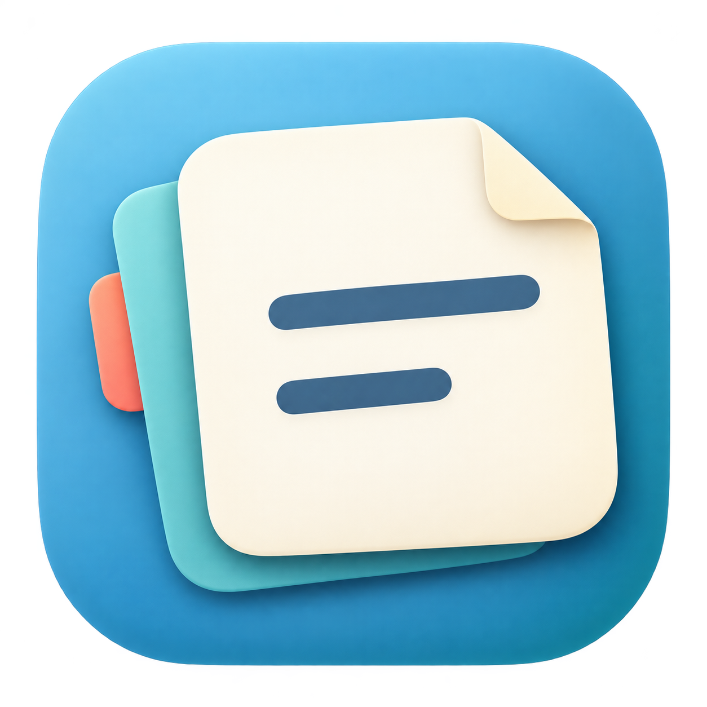
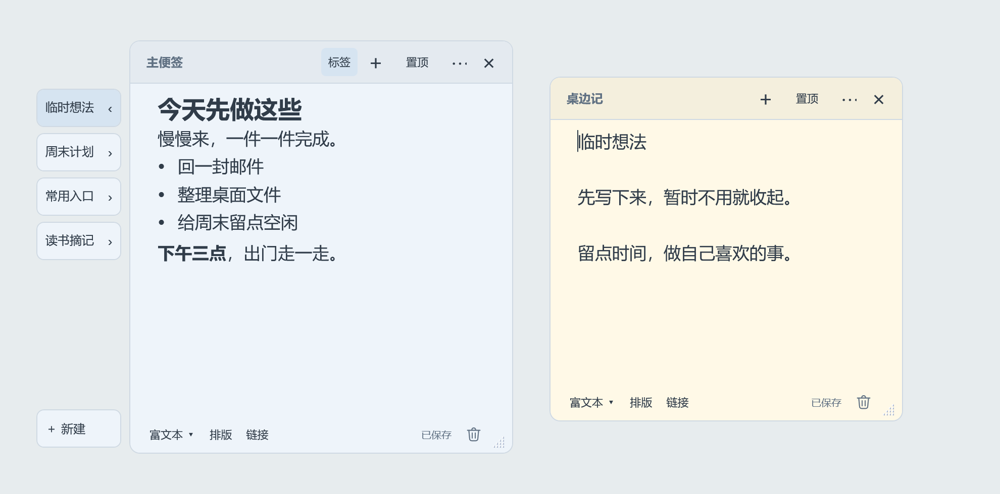
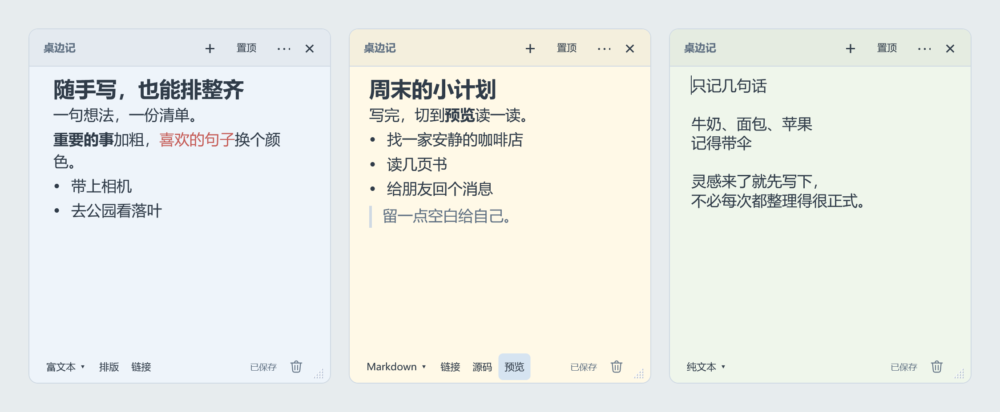
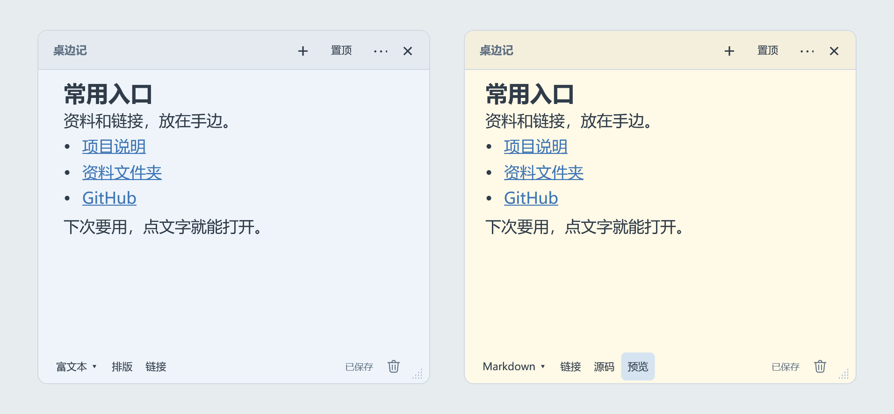

# 桌边记

**随手记，收整齐**

想到一句话，先记下来；常用的资料和链接，留在手边。便签多了，就收起来，需要时再展开。

桌边记是一款 Windows 桌面便签，支持富文本、Markdown 和纯文本。

[下载 Windows 版](https://github.com/hezhushizaishi/zhuobianji/releases/latest/download/Zhuobianji.exe) · [版本说明与附件](https://github.com/hezhushizaishi/zhuobianji/releases/latest) · [使用说明](docs/使用说明.md)

## 便签多了，就收起来

把暂时不用的便签收进一张主便签，桌面上只留眼前要用的。

点一下左侧标签展开，再点一下收回。也可以拖动标签，把常用的放在前面。

## 按自己的习惯写

想加粗、改颜色、写列表，用富文本；习惯 Markdown，就写完切到预览；只想记几句话，也有纯文本。

文字会自动保存。颜色、字体、透明度和快捷键，都可以在设置里调整。

## 常用入口，放在正文里

带链接的文字可以直接粘贴。点击网站会打开浏览器，点击本地文件会打开所在文件夹并选中文件。

记录和常用入口放在一起，省得再去翻找。

## 开始使用

下载 Windows x64 版，放进一个普通文件夹，双击 `Zhuobianji.exe` 就能开始写。内含运行库，无需另行安装。

右上角 **×** 会保存并关闭，之后可以从托盘或收纳标签找回。**垃圾桶**会先询问，确认后永久删除。

便签和设置都在程序旁边的 `Data` 文件夹。备份或换电脑时，先退出程序，再复制整个程序文件夹。

---

这是我的第一个开源项目。需求、取舍和试用反馈由我参与，代码与文档全程通过 Agent 协作完成。

感谢 [sysdzw/WeNote](https://github.com/sysdzw/WeNote) 提供的便签功能与交互思路，为桌边记带来了最初的启发。

如果用起来有什么不顺手的地方，欢迎在 Issue 里告诉我。

[使用说明](docs/使用说明.md) · [源码导航](src/README.md) · [MIT 许可](LICENSE)
