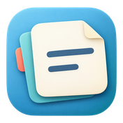
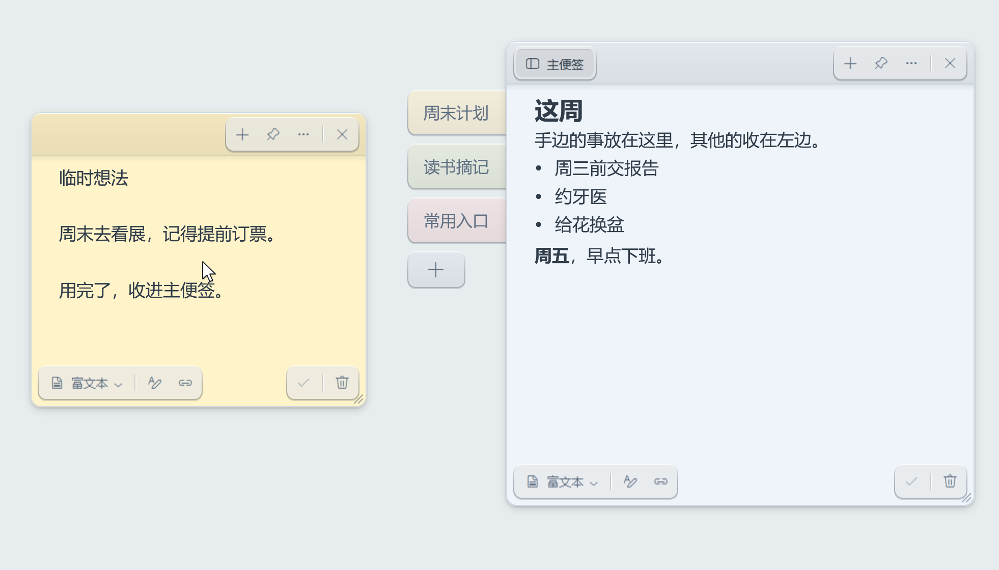
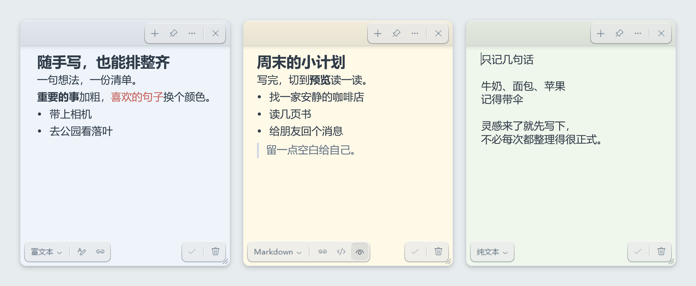
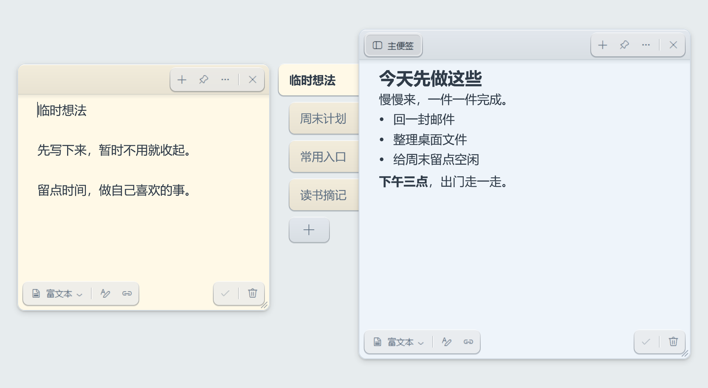
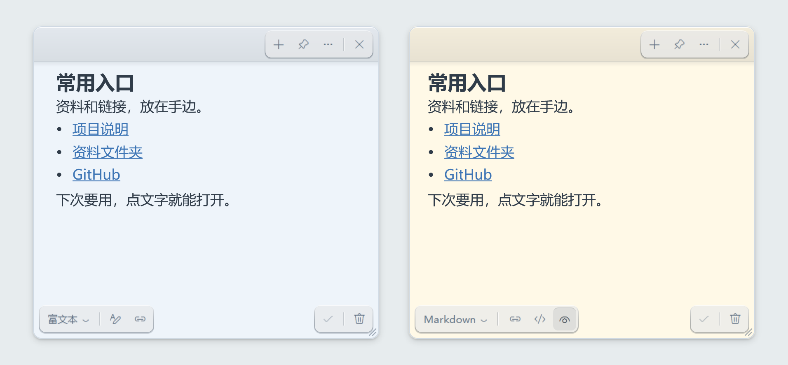
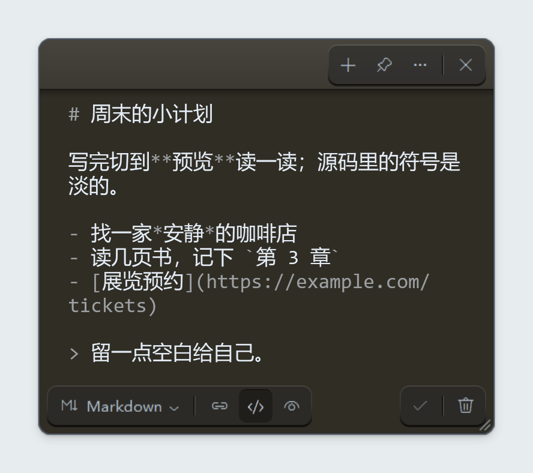
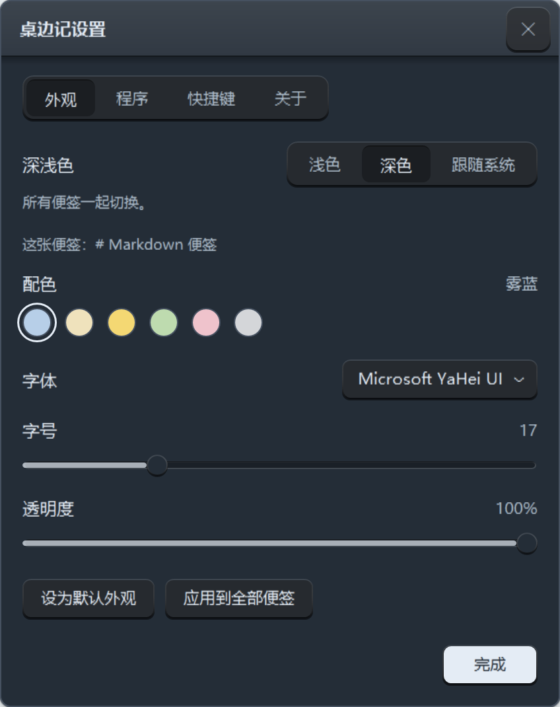

# 桌边记

**随手记，收整齐**

想到一句话，先记下来；常用的资料和链接，留在手边。 
便签多了，就收进一张主便签，桌面上只留眼前要用的。

版本 1.0.0 · [使用说明](docs/使用说明.md) · [版本记录](https://github.com/hezhushizaishi/zhuobianji/releases) · [English](#english)

 

 

<table>
<tr>
<td width="33%" valign="top">

**✍️ 三种写法** 
富文本、Markdown、纯文本，随时切换，自动保存。

</td>
<td width="33%" valign="top">

**🗂️ 收成标签** 
便签多了收进主便签，点标签抽出来，再点收回。

</td>
<td width="33%" valign="top">

**🔗 链接放手边** 
粘贴网址、拖进文件都会变成链接，Ctrl+单击就打开。

</td>
</tr>
<tr>
<td valign="top">

**📌 贴在桌面** 
待在所有窗口下面，像桌上的纸条；也能置顶。

</td>
<td valign="top">

**🌙 深浅色** 
整个程序一起换，也可以跟随系统。

</td>
<td valign="top">

**🔒 只在本机** 
不联网，没有账号，便签就存在程序旁边。

</td>
</tr>
</table>

## 看看它

### 三种写法

想加粗、改颜色、写列表，用富文本；习惯 Markdown，写完切到预览；只想记几句话，就用纯文本。格式随时能换，可能丢掉排版时会先说一声。

### 收成标签

在 ⋯ 菜单里把一张设为主便签，其他的收纳进去，就成了它左边的标签。点开的便签可以单独编辑，标签能拖动排序，最下面的 ＋ 直接新建一张收着的。

### 链接放在正文里

粘贴带链接的文字，网址显示成域名和路径，标题照样保留；从资源管理器拖进来的文件也会变成链接。光标停在链接上出现卡片，Ctrl+单击直接打开。

### 深色和外观

深浅色整个程序一起换，也可以跟随系统。配色、字体、字号和透明度每张便签各自调，调好一张，字体、字号和透明度也能一键用到全部。Markdown 源码里，`#`、`**`、链接地址这些符号淡一些，正文更好读。

 

## 开始用

1. **[下载 Zhuobianji.exe](https://github.com/hezhushizaishi/zhuobianji/releases/latest/download/Zhuobianji.exe)**，放进一个普通文件夹（比如 `D:\桌边记`）。
2. **双击打开**。不用安装，也不用另装运行库；之后它待在托盘里。
3. **Ctrl+Alt+N 新建便签**。便签多了，在 ⋯ 菜单里选「设为主便签」，其他的选「收纳到主便签」。

便签和设置都存在程序旁边的 `Data` 文件夹。备份、换电脑时先从托盘退出，再复制整个文件夹；升级就用新版替换旧的 exe，`Data` 不用动。右上角 **×** 是保存并关闭，不会删除。

桌边记不联网，没有同步和手机版，也不是笔记库（没有文件夹和全文搜索）；界面只有中文。

## 快捷键

| 按键 | 作用 |
| --- | --- |
| Ctrl+Alt+N | 新建便签（全局，设置里可以改） |
| Ctrl+Alt+空格 | 显示／隐藏全部便签（全局，设置里可以改） |
| Ctrl+N | 新建一张，错开一点叠在这张上面 |
| Ctrl+W | 保存并关闭这张，之后从托盘或标签找回 |
| Ctrl+Shift+T | 置顶／取消置顶 |
| Ctrl+Shift+V | 按原文粘贴 |
| Ctrl+单击 | 打开链接 |
| Ctrl+Shift+Q | 保存全部并退出 |

## 小而轻

| 约 0.75 秒 | 约 63 MB | 400 多项 |
| :---: | :---: | :---: |
| 双击到便签出现 | 常驻内存（10 张便签） | 功能检查，每次改完都跑一遍 |

程序 145 MB，因为里面带着 .NET 运行库和思源黑体，下载后不用再装别的。便签用软件画，不占显卡；收着的便签点开时才建窗口。

## 来历

这是我的第一个开源项目，最初受 [sysdzw/WeNote](https://github.com/sysdzw/WeNote) 的便签功能和交互启发。

要做什么、怎么取舍，由我决定，每天也在自己用、自己试。代码和文档全程由 AI 编程助手完成：最早的版本是 Codex 写的，之后由 Claude 重构、打磨，再请 Codex 复审。

用起来有什么不顺手的地方，欢迎在 [Issue](https://github.com/hezhushizaishi/zhuobianji/issues) 里告诉我。

[使用说明](docs/使用说明.md) · [开发说明](docs/开发说明.md) · [版本记录](https://github.com/hezhushizaishi/zhuobianji/releases) · [MIT 许可](LICENSE)

## English

**Zhuobianji** (桌边记, “notes by the desk”) is a small sticky-notes app for Windows 10/11. Write in rich text, Markdown or plain text; when notes pile up, collect them into one main note as tabs along its left edge and pull one out when you need it.

Everything stays in a `Data` folder next to the program: no install, no account, no sync. The interface is Chinese only. [Download Zhuobianji.exe](https://github.com/hezhushizaishi/zhuobianji/releases/latest/download/Zhuobianji.exe) · MIT License.
